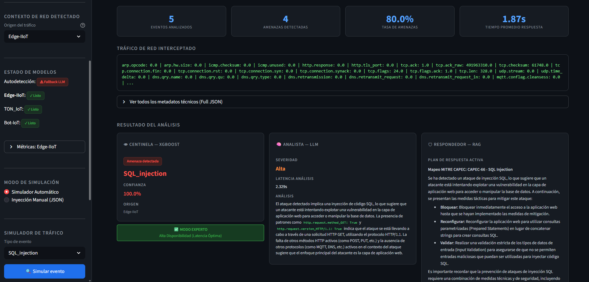
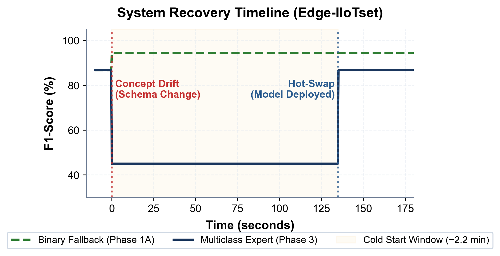
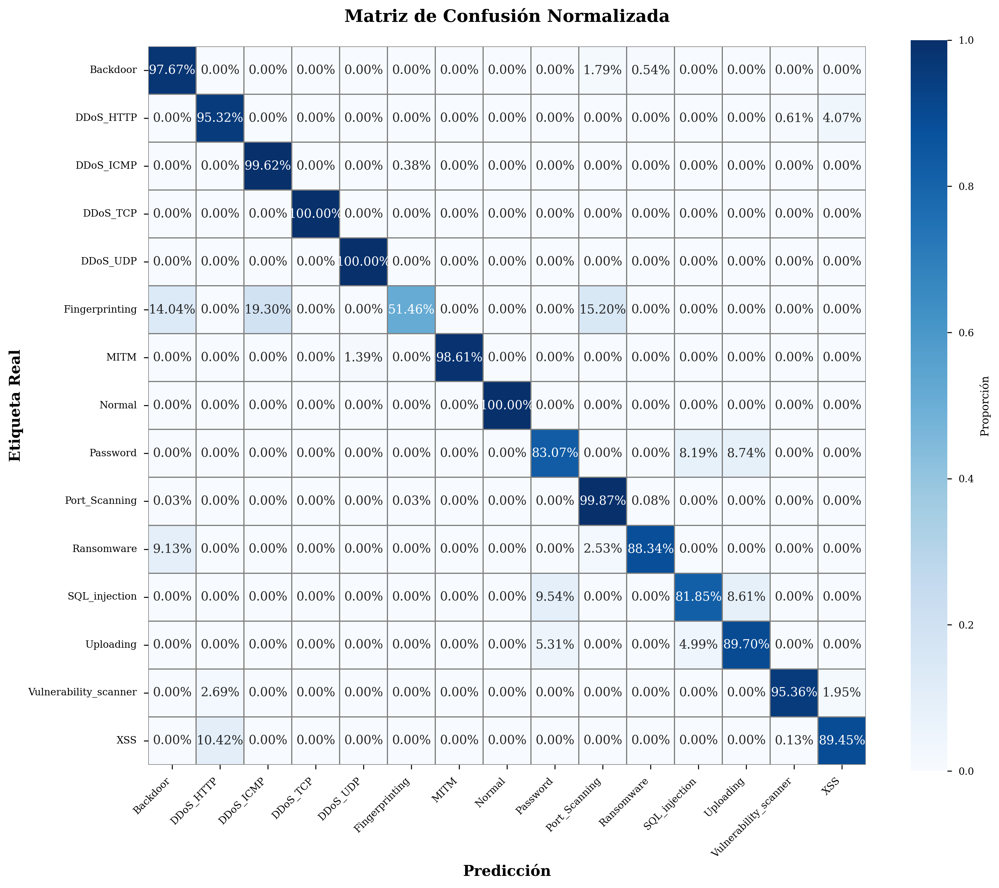

<div align="center">

# 🛡️ Multi-Agent IoT Intrusion Detection System (IDS)
### *Active High Availability with Zero-Shot LLM Schema Healing, Ultra-Fast XGBoost Inference, and Grounded RAG Incident Response (MITRE CAPEC)*

[](https://www.python.org/)
[](https://streamlit.io/)
[](https://xgboost.readthedocs.io/)
[](https://groq.com/)
[](https://github.com/facebookresearch/faiss)
[](https://www.uc3m.es/)
[](https://creativecommons.org/licenses/by-nc-nd/4.0/)

**Master's Thesis in Cybersecurity (2025–2026)**  
*Universidad Carlos III de Madrid (UC3M)*  
**Author:** [María López Padilla](https://mariaalopez4.github.io) · **Supervisors:** Alfonso A. Sánchez-Macián Pérez & Pablo Mateo Torrejón  
📄 **[Read Full Academic Thesis (PDF)](docs/memoria_tfm_maria_lopez.pdf)**

---



</div>

---

## 🌟 Executive Summary & Key Results

Conventional Intrusion Detection Systems (IDS) in IoT environments struggle with the **Cold Start problem**: when deployed in networks with unseen telemetry schemas, feature mismatches degrade or invalidate supervised classifiers. Operators are forced either to leave network traffic unprotected or enforce service downtime while new data is collected and models are retrained.

This project introduces a **Hybrid Multi-Agent Architecture** engineered for **Zero Downtime**:
* 🛡️ **Phase 1 (Zero-Shot Survival)**: When encountering an unfamiliar schema, the **Normalizer Agent (LLM / Llama 3.3)** dynamically normalizes features on-the-fly into a 12-dimensional canonical space, sustaining **94.25% binary detection accuracy** from second zero.
* ⚡ **Phases 2 & 3 (Asynchronous Hot-Swap)**: The Central Orchestrator spawns a background thread to train a high-dimensional expert model (< 2.5 minutes) and executes a transparent *hot-swap* without interrupting traffic, restoring full multiclass classification with a **96.68% weighted F1-score** and **sub-5 ms latency**.
* 🧠 **Evidence-Grounded Mitigation (RAG)**: The **Responder Agent** queries a persistent **FAISS** vector store over the **MITRE CAPEC** taxonomy, producing deterministic, actionable countermeasure plans that eliminate LLM hallucinations.

### Performance Highlights

| Metric | Phase 1 (Survival / Fallback) | Phase 3 (Expert Hot-Swapped) |
| :--- | :---: | :---: |
| **Inference Latency** | ~800 ms (Zero-shot LLM inference) | **< 4.2 ms (Native XGBoost)** |
| **Binary Detection Accuracy** | **94.25%** | **98.40%** |
| **Multiclass F1-Score (14 Attack Classes)** | N/A (Binary triage mode) | **96.68%** |
| **Mean Time to Recovery (MTTR)** | **0 seconds (Zero Downtime)** | **< 150 seconds (Hot-Swap)** |
| **Schema Alignment** | Dynamic Zero-Shot LLM Mapping | Native High-Dimensional Classifier |

---

## 🏛️ System Architecture

```mermaid
graph TD
    %% INGESTION
    A[Live IoT Network Telemetry] --> O{Central Orchestrator}
    
    %% HIGH AVAILABILITY SUBSYSTEM
    subgraph "High Availability Subsystem (Fault Tolerance)"
        O -- "Unseen Schema (Cold Start)" --> N[Normalizer Agent / LLM]
        N -- "On-the-fly Semantic Mapping" --> S_Base[Sentinel Base (Universal Fallback)]
        O -. "Spawn Async Thread" .-> ET[Background Model Retraining]
        ET -. "Transparent Hot-Swap" .-> S_Expert
    end

    %% DETECTION SUBSYSTEM (TIER 1)
    subgraph "Tier 1: Ultra-Fast Real-Time Detection (XGBoost)"
        O -- "Known Schema" --> S_Expert[Expert Sentinel Agent]
        S_Base --> Eval{Is Attack / Anomaly?}
        S_Expert --> Eval
    end
    
    Eval -- "Legitimate Traffic" --> Fin[Allowed Traffic - Flow Complete]
    
    %% REASONING SUBSYSTEM (TIER 2)
    subgraph "Tier 2: Cognitive Reasoning & Incident Response (LLM + RAG)"
        Eval -- "Attack Detected" --> Ana[Analyst Agent (Llama 3.3 70B)]
        Ana -- "Context & Severity (MITRE ATT&CK)" --> R[Responder Agent (RAG)]
        KB[(MITRE CAPEC Knowledge Base)] -. "Vector Search (FAISS)" .-> R
        R --> Rep[Comprehensive Incident Report]
    end

    %% VISUAL STYLES
    classDef LLM fill:#4b1d52,stroke:#a371f7,stroke-width:2px,color:#fff;
    classDef ML fill:#1a2f23,stroke:#3fb950,stroke-width:2px,color:#fff;
    classDef Core fill:#1f4277,stroke:#58a6ff,stroke-width:2px,color:#fff;
    
    class N,Ana,R LLM;
    class S_Base,S_Expert,ET ML;
    class O Core;
```

### Specialized Agents & Roles

1. **Central Orchestrator (`src/orquestador.py`)**: Acts as the central controller, managing incident workflows, finite state machines, and asynchronous background training threads.
2. **Normalizer Agent (`src/agente_normalizador.py`)**: Employs zero-shot LLM reasoning to map unfamiliar telemetry fields to an established 12-feature canonical representation.
3. **Sentinel Agent (`src/agente_centinela.py`)**: Ultra-fast XGBoost classifier distinguishing 14 distinct IoT attack families (DDoS UDP/TCP, Injection, Ransomware, Port Scanning, Backdoors...) at microsecond speeds.
4. **Analyst Agent (`src/agente_analista.py`)**: Cognitive engine that enriches raw alert telemetry with human-readable threat context and maps incidents to the **MITRE ATT&CK** framework.
5. **Responder Agent (`src/agente_respondedor.py`)**: RAG pipeline built with `sentence-transformers` embeddings and FAISS index over the **MITRE CAPEC** taxonomy, providing grounded, authoritative defense plans.

---

## 🚀 Quickstart in 3 Minutes

A balanced sample dataset (`data/sample_EdgeIIoTset.csv`) and attack templates (`data/templates_ataques.json`) are bundled in the repository. **You do not need to download gigabytes of raw data to run and test the interactive web SOC.**

### 1. Clone the Repository
```bash
git clone https://github.com/mariaalopez4/ids-multiagente-iot-rag.git
cd ids-multiagente-iot-rag
```

### 2. Set Up Virtual Environment & Dependencies
```bash
python -m venv venv

# On Linux / macOS:
source venv/bin/activate
# On Windows (PowerShell):
.\venv\Scripts\Activate.ps1

pip install -r requirements.txt
```

### 3. Configure API Credentials
The system uses LLaMA models hosted via Groq's low-latency inference engine.
1. Obtain a free API key at [console.groq.com](https://console.groq.com/).
2. Copy `.env.example` to `.env`:
   ```bash
   cp .env.example .env
   ```
3. Set your key inside `.env`:
   ```text
   GROQ_API_KEY=gsk_your_groq_api_key_here
   ```

### 4. Launch the Interactive SOC Dashboard (Streamlit)
```bash
streamlit run src/app.py
```
The web dashboard will automatically open in your default browser at `http://localhost:8501`.

---

## 📊 Application Features & Interactive Demo

* **Live Traffic Simulation**: Inject real IoT telemetry packets with a single click or select specific attack vectors (DDoS UDP, SQL Injection, Ransomware, Port Scanning...).
* **Manual Payload & Log Injection**: Test zero-shot normalizer performance with arbitrary custom JSON logs.
* **Cold Start & Hot-Swap Demo**: Upload an unseen CSV schema to observe real-time schema healing and hot-swapping to a newly trained model without dropping active traffic.
* **SOC Telemetry & Audit Logs**: Track attack distribution, MITRE ATT&CK alignment, and agent processing latencies in real time.

<div align="center">
  
</div>

---

## 🔬 Benchmarking & Empirical Validation

To reproduce the benchmark figures and experiments reported in the academic thesis:

```bash
# Evaluate Expert Sentinel (Phase 3 - Native XGBoost)
python src/benchmark_fase3.py

# Evaluate Survival Mode (Phase 1 - LLM Normalizer + Fallback Classifier)
python src/benchmark_fase1.py

# Generate academic confusion matrix and metric reports
python src/generar_metricas.py
```

<div align="center">
  
</div>

> **Full Datasets (Optional):** For large-scale evaluations on full datasets (> 1.5M network flows, ~1 GB):
> * [Edge-IIoTset (Google Drive)](https://drive.google.com/file/d/1FIF5nS2N4sHTsE_hac5YhnhSeluDTBw_/view?usp=drive_link) → Place in `data/EdgeIIoTset.csv`.
> * TON_IoT and Bot-IoT can optionally be placed at `data/TON_IoT.csv` and `data/Bot-IoT.csv`.

---

## 📁 Repository Structure

```text
├── data/
│   ├── sample_EdgeIIoTset.csv      # Balanced lightweight sample for out-of-the-box demo
│   ├── templates_ataques.json      # Preconfigured attack payloads for manual testing
│   ├── features_comunes.json       # 12 universal canonical features
│   ├── learned_schemas.json        # Cached schemas learned by the Normalizer
│   └── mitre_capec_kb.txt          # MITRE CAPEC knowledge base document
├── docs/
│   ├── memoria_tfm_maria_lopez.pdf # Full Master's Thesis manuscript (PDF)
│   └── images/                     # Architecture diagrams and SOC screenshots
├── modelos/
│   ├── xgboost_model.pkl           # Expert Sentinel model (Edge-IIoT)
│   ├── xgboost_fallback_model.pkl  # Universal Fallback model (12 canonical features)
│   ├── xgboost_model_TON_IoT.pkl   # Expert Sentinel model (TON_IoT)
│   └── xgboost_model_Bot_IoT.pkl   # Expert Sentinel model (Bot-IoT)
├── resultados/                     # Evaluation metrics, charts, and benchmark logs
├── src/
│   ├── app.py                      # Interactive Streamlit SOC Dashboard
│   ├── orquestador.py              # Central Orchestrator & high availability logic
│   ├── agente_centinela.py         # Sub-millisecond anomaly detection (XGBoost)
│   ├── agente_normalizador.py      # Zero-shot semantic mapping (Groq / Llama 3.3)
│   ├── agente_analista.py          # Cognitive context & MITRE ATT&CK mapping
│   ├── agente_respondedor.py       # Grounded mitigation engine (FAISS + CAPEC RAG)
│   ├── config.py                   # Global configuration & path resolution
│   ├── logic_utils.py              # Data validation and feature utilities
│   ├── ui_utils.py                 # Streamlit UI theme and alert widgets
│   └── benchmark_fase*.py          # Benchmarking suites (Phases 1 & 3)
├── requirements.txt                # Python dependencies
├── .env.example                    # Environment template
└── README.md                       # Main documentation
```

---

## 👤 Author & Contact

**María López Padilla**  
*Cybersecurity & AI Engineer · Universidad Carlos III de Madrid (UC3M)*  

* 🌐 **Personal Portfolio:** [mariaalopez4.github.io](https://mariaalopez4.github.io)
* 🐙 **GitHub:** [@mariaalopez4](https://github.com/mariaalopez4)

---

## 📜 License & Citation

This project is licensed under the **Creative Commons Attribution-NonCommercial-NoDerivatives 4.0 International License (CC BY-NC-ND 4.0)**.

If you find this work or architecture useful for your research, please cite:

```bibtex
@mastersthesis{lopez2026multiagent,
  author       = {López Padilla, María},
  title        = {Multi-agent Architecture for IoT Threat Detection Using Language Models},
  school       = {Universidad Carlos III de Madrid},
  year         = {2026},
  month        = {July},
  type         = {Master's Thesis}
}
```
